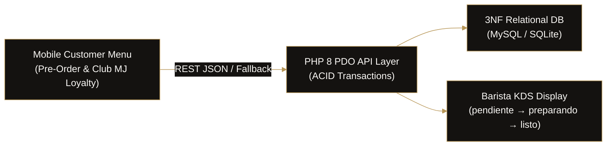

# ☕ SaaS MJ CAFÉ - FES Cuautitlán Campo 4
> **Plataforma Web de Pedidos Anticipados & Programa de Lealtad Digital para MJ Café (San Sebastián Xhala, Edomex)**  
> *Proyecto universitario de programación & Producto SaaS comercial de [XAOL Studio](https://github.com/Xaol-Studio).*

<p align="left">
  <a href="https://mj-cafe.vercel.app"></a>
  <a href="https://mj-cafe.vercel.app/cocina"></a>
  <a href="https://github.com/Xaol-Studio"></a>
</p>

<p align="left">
  
  
  
  
</p>



---

## 🔗 Enlaces Rápidos en Producción

- 🌐 **Tienda / Menú de Clientes:** [https://mj-cafe.vercel.app](https://mj-cafe.vercel.app)
- 👨‍🍳 **Pantalla de Barista / Cocina (KDS):** [https://mj-cafe.vercel.app/cocina](https://mj-cafe.vercel.app/cocina)
- 🎟️ **Programa de Lealtad (Club MJ):** Integrado en barra y modal de la tienda

---

## 📖 Descripción del Proyecto

**MJ CAFÉ** es una cafetería de especialidad y brunch ubicada en **Av. Benito Juárez #1, San Sebastián Xhala**, a escasos metros del acceso vehicular de **FES Cuautitlán Campo 4 (UNAM)**.

Este sistema soluciona el problema de los estudiantes y profesores que cuentan únicamente con **10 a 15 minutos entre bloques de clase**, permitiéndoles ordenar con anticipación desde su teléfono móvil y recoger su café y alimentos en barra sin hacer fila ni pagar sobreprecio de plataformas de delivery.

---

## 🏛️ Estructura del Proyecto

```
mj-cafe/
├── index.html                    # Redirección automática a la aplicación principal
├── README.md                     # Documentación general y guía rápida
│
├── database/                     # Capa de datos relacional (3FN)
│   ├── schema.sql                # DDL para MySQL / MariaDB con claves foráneas
│   ├── schema_sqlite.sql         # DDL optimizado para pruebas en SQLite local
│   ├── seeds.sql                 # Menú real de MJ Café (frappés, café, bagels)
│   └── setup_sqlite.php          # Inicializador de SQLite local
│
├── backend/                      # Capa de servicios y lógica de negocio (PHP)
│   ├── config/
│   │   └── database.php          # Gestor de conexión PDO (SQLite/MySQL)
│   ├── api/
│   │   ├── productos.php         # Catálogo de productos y categorías con INNER JOIN
│   │   ├── pedidos.php           # Registro de pedidos con transacción PDO y consulta por folio
│   │   ├── lealtad.php           # Consulta y canje de la tarjeta de 6 sellos (Club MJ)
│   │   └── cocina.php            # Comandas en tiempo real y corte de ventas para el barista
│   ├── index.php                 # Directorio informativo de endpoints REST
│   └── a.php                     # Redirección principal
│
├── html/                         # Vistas del usuario
│   ├── index.html                # Menú para clientes, recolección y tarjeta Club MJ
│   └── cocina.html               # Pantalla de cocina (KDS) para el barista
│
├── css/
│   └── style.css                 # Paleta de especialidad (espresso, latte, crema)
│
└── js/                           # Lógica clienteside
    ├── api.js                    # Cliente HTTP con fallback mock inteligente
    └── main.js                   # Carrito, filtros por categoría y eventos UI
```

---

## 🚀 Inicio Rápido (Quickstart)

### Opción A: Modo SQLite Local (Cero dependencias externas)
1. **Inicializar la base de datos de prueba:**
   ```bash
   php database/setup_sqlite.php
   ```
2. **Iniciar el servidor local embebido de PHP:**
   ```bash
   php -S localhost:8000
   ```
3. **Abrir en tu navegador:**
   - Menú de clientes: [http://localhost:8000/html/index.html](http://localhost:8000/html/index.html)
   - Pantalla de barista / cocina: [http://localhost:8000/html/cocina.html](http://localhost:8000/html/cocina.html)

### Opción B: Modo MySQL / XAMPP
1. Abre phpMyAdmin y crea la base de datos `mj_cafe_db`.
2. Importa `database/schema.sql` y luego `database/seeds.sql`.
3. En `backend/config/database.php`, cambia la línea:
   ```php
   private const DB_DRIVER = 'mysql';
   ```

---

## 🔌 Especificación de la API REST

| Método | Endpoint | Descripción |
| :--- | :--- | :--- |
| `GET` | `/backend/api/productos.php` | Devuelve el catálogo completo o filtrado (`?categoria=1`) |
| `POST` | `/backend/api/pedidos.php` | Registra un nuevo pedido con transacción atómica |
| `GET` | `/backend/api/pedidos.php?folio=MJ-2026-X` | Consulta el estado y detalle de un pedido |
| `GET` | `/backend/api/lealtad.php?telefono=55...` | Consulta los sellos acumulados en Club MJ |
| `POST` | `/backend/api/lealtad.php` | Canjea un café de cortesía tras 6 sellos |
| `GET` | `/backend/api/cocina.php` | Lista los pedidos activos para la pantalla de barista |
| `POST` | `/backend/api/cocina.php` | Actualiza el estado (`pendiente` ➔ `preparando` ➔ `listo`) |

---

## 👥 Equipo de Desarrollo

- **Ian Miguel Delgado Huitron ([@iamhuitron](https://github.com/iamhuitron)):** Arquitectura de Bases de Datos, Modelado Relacional y Servicios Backend en PHP.
- **Jorge Alberto Barrios Rosas ([@GorchRosas](https://github.com/GorchRosas)):** Frontend, Experiencia de Usuario (UI/UX) y Pantalla KDS de Barista.
- **Agencia:** [XAOL Studio](https://github.com/Xaol-Studio)
