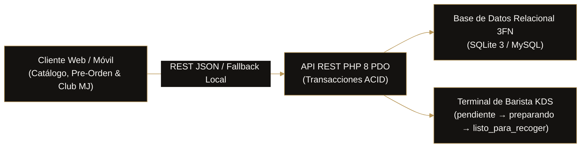

# MJ CAFÉ — Plataforma Web de Pre-Orden & Lealtad (FES Cuautitlán Campo 4)

> **Universidad Nacional Autónoma de México • Facultad de Estudios Superiores Cuautitlán**  
> **Departamento de Matemáticas • Licenciatura en Informática • Semestre 2027-I**  
> Plataforma Web de Pedidos Express en Barra y Programa de Lealtad Digital para **MJ CAFÉ** (San Sebastián Xhala, Cuautitlán Izcalli, Edo. Méx.).

<p align="left">
  <a href="https://mj-cafe.vercel.app"></a>
  <a href="https://mj-cafe.vercel.app/cocina"></a>
  <a href="https://github.com/Xaol-Studio"></a>
</p>

<p align="left">
  
  
  
  
</p>



---

## Enlaces en Producción

- **Tienda / Menú para Clientes:** [https://mj-cafe.vercel.app](https://mj-cafe.vercel.app)
- **Terminal de Barista / Cocina (KDS):** [https://mj-cafe.vercel.app/cocina](https://mj-cafe.vercel.app/cocina)
- **Programa de Lealtad Digital (Club MJ) & Rastreo por Folio:** Integrados en la barra de navegación y dock móvil.

---

## Parte I — Estructura Teórica del Proyecto

### 1. Sector Económico
**Sector Terciario — Industria de Servicios de Alimentos y Bebidas (Cafetería de Especialidad y FoodTech).**

Se eligió este sector porque **MJ CAFÉ** se ubica en **Av. Benito Juárez #1, San Sebastián Xhala**, frente al acceso vehicular de **FES Cuautitlán Campo 4 (UNAM)**. Existe una demanda diaria continua, predecible y concentrada en ventanas horarias específicas (cambios de clase y bloques académicos) por parte de estudiantes, docentes y personal administrativo que requieren bebidas de especialidad y alimentos frescos con tiempos mínimos de espera.

### 2. Misión y Visión
- **Misión:** Ofrecer café de especialidad, bebidas artesanales y alimentos preparados al momento para la comunidad de FES Cuautitlán Campo 4, eliminando las filas en horas pico mediante una plataforma web de pedidos anticipados y recolección directa en barra.
- **Visión:** Consolidarse a mediano y largo plazo como la cafetería de referencia para estudiantes y profesionales en la zona norte del Estado de México, combinando hospitalidad presencial con herramientas digitales propias que optimicen la operación diaria y fortalezcan la lealtad de cada cliente.

### 3. Planteamiento del Problema
Durante los recesos y cambios de clase en Campo 4 (ventanas de **10 a 15 minutos**), los puntos de venta cercanos sufren saturación en barra y en toma de pedidos presencial. Esto ocasiona tres problemas concretos:
1. **Pérdida de tiempo efectivo de traslado y espera:** Los estudiantes desisten de comprar al ver filas de más de 15 minutos.
2. **Desorganización operativa en barra:** La captura manual de comandas y personalizaciones (*leche vegetal, nivel de azúcar, hielo*) genera errores de preparación y retrasos.
3. **Pérdida de retención por tarjetas físicas:** Las tarjetas de sellos impresas en cartón se extravían con facilidad y no permiten medir la frecuencia de visita.

**Solución:** Una plataforma web propia de pre-orden (*Pick-up Express*) acoplada a una terminal de cocina (KDS) y un registro digital de sellos vinculado al teléfono del cliente (**Club MJ**).

### 4. Objetivos Claros

#### Objetivo General
Reducir en más de un **60%** el tiempo de espera presencial en barra (pasando de filas superiores a 15 minutos a una recolección directa en menos de 5 minutos) mediante una aplicación web dinámica de pedidos anticipados con cobertura del **100%** del catálogo de MJ CAFÉ.

#### Objetivos Específicos
1. **Modelado de Datos:** Diseñar e implementar una base de datos relacional normalizada en Tercera Forma Normal (3FN) compatible con SQLite 3 y MySQL para gestionar categorías, productos, pedidos, detalles y clientes de lealtad.
2. **Interfaz Mobile-First:** Desarrollar una interfaz web sobria, responsiva y accesible con un máximo de 3 tipografías web legibles, enfocada en compras rápidas desde dispositivos móviles entre clases.
3. **Servicios Backend y Lealtad:** Construir una API RESTful en PHP 8 con PDO y transacciones ACID para validar precios en servidor, generar folios únicos (`MJ-AAAA-XXXX`) y acreditar sellos automáticos en Club MJ (6to café en cortesía).
4. **Control Operativo en Barra (KDS):** Implementar una pantalla de cocina en tiempo real que permita al barista actualizar el ciclo de vida de cada comanda (`pendiente` → `preparando` → `listo_para_recoger` → `entregado`) y visualizar métricas de turno.

### 5. Estrategia y Análisis FODA

| Dimensión | Factores Clave |
| :--- | :--- |
| **Fortalezas** | • **Ubicación estratégica:** A 1 minuto del acceso vehicular de FES Cuautitlán Campo 4.<br>• **Recolección directa en barra sin filas en horas pico:** Operación 100% presencial en tienda (solo pick-up, sin repartidores ni intermediarios).<br>• **Fidelización digital (Club MJ):** Acumulación automática por número telefónico (6to café en cortesía).<br>• **Resiliencia técnica:** Backend PHP/PDO con respaldo automático en navegador (`localStorage`) para demostraciones o contingencias de red. |
| **Oportunidades** | • **Alta rotación estudiantil diaria:** Miles de estudiantes y docentes con ventanas de 10–15 min entre clases.<br>• **Creación de hábito digital:** Adopción rápida de pre-orden desde celular y pagos por SPEI/Dimo.<br>• **Expansión futura:** Posibilidad de integrar paquetes de desayuno por facultad y avisos por WhatsApp. |
| **Debilidades** | • **Capacidad física en barra:** La máquina de espresso y la plancha tienen un límite de producción simultánea en horas pico (11:00–13:00 hrs).<br>• **Validación manual de pagos:** Los pagos en efectivo en barra y transferencias SPEI requieren confirmación visual del barista.<br>• **Dependencia de conectividad en local:** La sincronización de la terminal KDS depende de conexión estable a internet en el establecimiento. |
| **Amenazas** | • **Competencia cercana:** Puestos ambulantes, cooperativas internas y cafeterías aledañas a Campo 4.<br>• **Periodos intersemestrales y vacaciones:** Disminución de demanda fuera del calendario escolar UNAM.<br>• **Fallas de red o servicio eléctrico:** Interrupciones temporales de internet en la zona de San Sebastián Xhala. |

### 6. Organización Visual y Estructura de Navegación
La plataforma separa de forma clara cada flujo para que el estudiante o barista encuentre lo que necesita sin pasos innecesarios:
- **Menú y Catálogo Principal (`/`):** Barra superior fija con acceso a búsqueda en tiempo real, filtros por categoría (*Café de Especialidad*, *Frappés & Frías*, *Alimentos & Bagels*, *Panadería & Postres*) y tarjetas con precio y tiempo de preparación.
- **Carrito Lateral y Pre-Orden:** Drawer deslizable que reúne personalizaciones, horario de recolección, método de pago y validación antes de generar el folio.
- **Rastreo por Folio y Club MJ:** Modales dedicados para consultar el avance de un pedido (`pendiente` → `preparando` → `listo_para_recoger`) y revisar los sellos acumulados por número telefónico.
- **Terminal de Barista KDS (`/cocina`) y Visor BD (`/db`):** Vistas operativas para gestionar comandas en 3 columnas y auditar las tablas en tiempo real.

---

## Parte II — Características Técnicas y de Diseño Web

### 7. Identidad, Representatividad y Originalidad
- **Definición del Tema y Enfoque del Sitio:** Plataforma digital para cafetería de especialidad y brunch estudiantil enfocada en la pre-orden para recolección en barra (*Pick-up*). Presenta:
  - Identidad institucional de **MJ CAFÉ** (ubicación, horarios de atención y enfoque universitario).
  - Catálogo interactivo organizado por categorías con fotografía, descripción, tiempo estimado de preparación y precio.
  - Flujo completo de carrito de compras, personalización por producto y selección de bloque horario de recolección.
  - Módulos de **Rastreo por Folio**, **Tarjeta Digital Club MJ** y **Terminal de Barista (KDS)**.

- **Identidad Visual — Paleta de Colores (`css/style.css`):**

| Token CSS | Código HEX | Rol Visual |
| :--- | :--- | :--- |
| `--color-bg` | `#0D0C0A` | **Obsidian Void** — Canvas base oscuro de alto contraste |
| `--color-surface` | `#141210` | **Espresso Surface** — Tarjetas de producto, paneles, modales y footer |
| `--color-surface-elevated` | `#1D1A16` | **Roasted Layer** — Formularios, badges, tarjetas de lealtad y menús |
| `--color-border` | `#262420` | **Subtle Border** — Líneas divisorias estructurales de `1px` |
| `--color-accent` | `#B89758` | **Oro Viejo / Crema** — Botones primarios, precios, folios y acentos |
| `--color-accent-hover` | `#D4B87A` | **Champagne** — Estados activos y hover de controles |
| `--color-text` | `#FAF8F5` | **Ivory Cream** — Titulares principales y texto de máximo contraste |
| `--color-text-body` | `#B0ABA0` | **Warm Stone** — Descripciones y texto de lectura continua |

- **Estilo Tipográfico (Máximo 3 fuentes declaradas):**
  1. **`Playfair Display` (Serif editorial):** Títulos de marca, hero y nombres de producto.
  2. **`Inter` (Sans-serif geométrica):** Textos de lectura, formularios, botones y navegación UI.
  3. **`JetBrains Mono` (Monospace técnica):** Precios en MXN, folios de recolección, tiempos de preparación, badges y contadores en KDS.

- **Contenido Propio y Personalizado:** Catálogo real de 14 bebidas y alimentos adaptado a preferencias locales, horarios sincronizados con salidas de clase (13:00 y 15:00 hrs), datos de ubicación en San Sebastián Xhala y reglas propias de recompensas.

### 8. Simplicidad y Pregnancia
- **Diseño limpio y directo:** Interfaz oscura minimalista libre de elementos distractivos, publicidad o saturación cromática, priorizando la legibilidad inmediata de precios, tiempos y botones de acción.
- **Navegación clara:**
  - En escritorio: barra superior fija (*sticky*) con acceso directo a *Rastrear Pedido*, *Club MJ*, *Cocina (KDS)* y *Carrito*.
  - En móvil (`<= 768px`): dock inferior táctil persistente, barra flotante de carrito cuando hay artículos agregados, filtros por categoría deslizables y buscador instantáneo sin zoom forzado en iOS Safari.

### 9. Arquitectura Web Básica
- **Tipo de Página Web:** **Página Web Dinámica** (conectada a base de datos relacional mediante API REST en PHP 8 PDO) combinada con **Tienda Online / E-commerce de Pre-orden (Pick-up)**.
- **Infraestructura (Propuesta):**
  - **Dominio propuesto:** `mjcafe.com.mx` (o `pedidos.mjcafe.com.mx`).
  - **URL activa de despliegue:** [https://mj-cafe.vercel.app](https://mj-cafe.vercel.app)
  - **Servidor Web / Hosting:** Vercel Edge Network (HTTPS/SSL automático para la capa frontend y enrutamiento limpio) + Servidor PHP 8.1+ con motor SQLite 3 / MySQL 3FN para entornos locales o VPS.

### 10. Escalabilidad (4 Factores Clave)

1. **Diseño:** Sistema basado en variables CSS (`:root` Design Tokens), grid responsivo automático (`repeat(auto-fill, minmax(280px, 1fr))`) y componentes independientes, lo que permite ampliar categorías o vistas (ej. panel de administrador) sin reescribir hojas de estilo.
2. **Optimización del Código:** JavaScript modular en ES6+ (`api.js` separado de `main.js`), consultas SQL preparadas con PDO (prevención de inyección SQL y reutilización de planes de ejecución), transacciones atómicas ACID en pedidos y carga diferida de imágenes (`loading="lazy"`).
3. **Optimización del Producto:** Preparado para incorporar pasarelas de pago en línea (Stripe, MercadoPago o CoDi), notificaciones automáticas por WhatsApp Business API cuando el barista marque `listo_para_recoger`, y módulo de inventario/recetas para descuento automático de insumos.
4. **Optimización del Hardware:** Desacoplamiento mediante PDO que permite migrar de SQLite en archivo único a un servidor dedicado MySQL/MariaDB o PostgreSQL con réplicas de lectura, integración con impresoras térmicas de tickets (ESC/POS) y tabletas dedicadas para la pantalla KDS en barra.

---

## Parte III — Estructura Técnica e Instalación

### Estructura del Proyecto

```text
mj-cafe/
├── index.html                    # Redirección automática a la tienda principal
├── vercel.json                   # Rutas limpias (/cocina, /menu) y cabeceras de seguridad
├── README.md                     # Documentación teórica, técnica y guía de despliegue
│
├── database/                     # Capa de datos relacional (3FN)
│   ├── schema.sql                # DDL para MySQL / MariaDB con claves foráneas
│   ├── schema_sqlite.sql         # DDL optimizado para SQLite 3
│   ├── seeds.sql                 # Catálogo inicial (14 productos, categorías y folios)
│   ├── setup_sqlite.php          # Script de inicialización de SQLite local
│   └── mj_cafe.sqlite            # Base de datos SQLite lista para pruebas locales
│
├── backend/                      # API RESTful y lógica de negocio (PHP 8 PDO)
│   ├── config/
│   │   └── database.php          # Gestor de conexión PDO (SQLite / MySQL)
│   ├── api/
│   │   ├── productos.php         # Catálogo de productos y categorías (INNER JOIN)
│   │   ├── pedidos.php           # Creación de pedidos con transacción PDO y consulta por folio
│   │   ├── lealtad.php           # Consulta y canje de sellos Club MJ
│   │   └── cocina.php            # Comandas activas y métricas del turno para KDS
│   └── index.php                 # Índice informativo de endpoints
│
├── html/                         # Vistas principales
│   ├── index.html                # Tienda, catálogo, carrito, rastreo, Club MJ e identidad
│   └── cocina.html               # Terminal de barista / cocina (KDS) en tiempo real
│
├── css/
│   └── style.css                 # Sistema de diseño oscuro, tokens CSS y layout responsivo
│
└── js/
    ├── api.js                    # Cliente HTTP REST con fallback resiliente en localStorage
    └── main.js                   # Lógica de tienda, carrito, filtros, rastreo y Club MJ
```

### Especificación de la API REST

| Método | Endpoint | Descripción |
| :--- | :--- | :--- |
| `GET` | `/backend/api/productos.php` | Devuelve el catálogo completo o filtrado (`?categoria=1`, `?populares=1`) |
| `POST` | `/backend/api/pedidos.php` | Registra un pedido validando precios en BD con transacción ACID y suma +1 sello |
| `GET` | `/backend/api/pedidos.php?folio=MJ-2026-101` | Consulta el estado y detalle de un pedido específico por folio |
| `GET` | `/backend/api/lealtad.php?telefono=5512345678` | Consulta los sellos acumulados y disponibilidad de recompensa |
| `POST` | `/backend/api/lealtad.php` | Canjea una bebida de cortesía al alcanzar 6 sellos |
| `GET` | `/backend/api/cocina.php` | Lista pedidos activos ordenados por prioridad y resumen de ventas |
| `POST` | `/backend/api/cocina.php` | Actualiza el estado (`pendiente` → `preparando` → `listo_para_recoger` → `entregado`) |

### Inicio Rápido en Entorno Local

#### Opción A: SQLite Local + PHP Embebido
1. Inicializar la base de datos SQLite (si aún no existe):
   ```bash
   php database/setup_sqlite.php
   ```
2. Iniciar el servidor local desde la raíz del proyecto:
   ```bash
   php -S localhost:8000
   ```
3. Abrir en el navegador:
   - Tienda / Clientes: `http://localhost:8000/html/index.html`
   - Terminal de Cocina (KDS): `http://localhost:8000/html/cocina.html`

#### Opción B: MySQL / XAMPP
1. Crear la base de datos `mj_cafe_db` desde phpMyAdmin o CLI de MySQL.
2. Importar `database/schema.sql` y posteriormente `database/seeds.sql`.
3. En `backend/config/database.php`, cambiar el controlador:
   ```php
   private const DB_DRIVER = 'mysql';
   ```

---

## Equipo de Desarrollo

- **Ian Miguel Delgado Huitron ([@iamhuitron](https://github.com/iamhuitron)):** Arquitectura de Bases de Datos (3FN), Servicios Backend en PHP 8 PDO y Despliegue.
- **Jorge Alberto Barrios Rosas ([@GorchRosas](https://github.com/GorchRosas)):** Desarrollo Frontend, Experiencia de Usuario (UI/UX) y Terminal KDS de Barista.
- **Institución:** Universidad Nacional Autónoma de México — FES Cuautitlán (Licenciatura en Informática, Semestre 2027-I).
